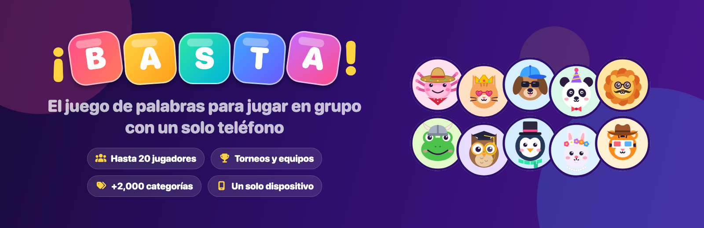
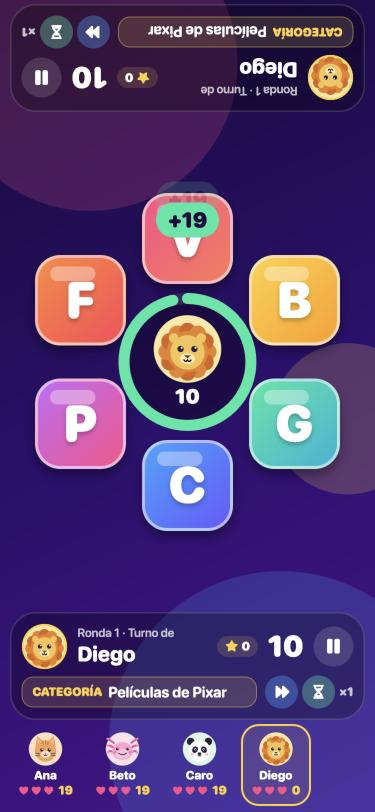
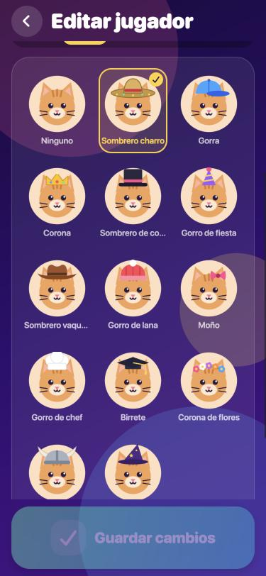
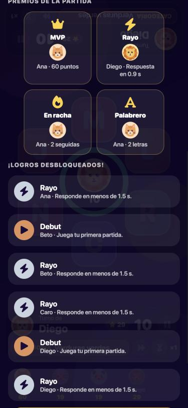
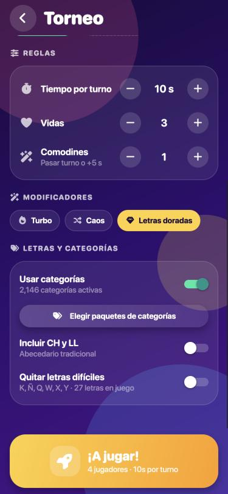
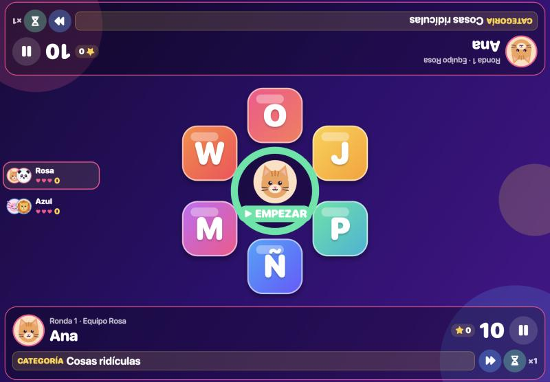
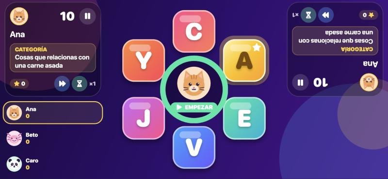

<p align="center">
  
</p>

<p align="center">
  <b>Pon el teléfono o la tableta en el centro de la mesa y que empiece el juego.</b><br/>
  Android · iOS · Expo SDK 58 + React Native 0.88 · TypeScript · Código abierto (MIT)
</p>

<p align="center">
  
  
  
  
</p>
<p align="center">
  
  
</p>

---

## ¿Cómo se juega?

1. Todos alrededor de la mesa con **un solo dispositivo** en el centro. El turno se muestra abajo **y arriba volteado**.
2. Sale una **categoría** (de más de **2,100**: *Frutas*, *Estados de México*, *Cosas que hay en un circo*…).
3. Hay **6 letras** del abecedario de México (27 con **Ñ**) alrededor del reloj.
4. En tu turno di una palabra de la categoría que empiece con una de esas letras y **tócala**. La letra cambia por otra y el turno pasa.
5. Si se acaba el **tiempo**, fallas. ¿Alguien dijo algo que no vale? **Pausa → “Alguien se equivocó”**.

## Funciones

| | |
| --- | --- |
| 🎮 **4 modos** | **Clásico** (eliminación), **Torneo** (vidas y rondas), **Puntos** (nadie sale, gana el mejor marcador) y **Equipos** (2–4 equipos que se turnan). |
| ✨ **Modificadores** | **Turbo** (el reloj se acelera), **Caos** (la categoría cambia cada turno) y **Letras doradas** (valen doble). |
| 🃏 **Comodines** | Pasar turno o +5 segundos, configurables por partida. |
| ⭐ **Puntos** | Por letra (las difíciles valen más), rapidez, rachas y letras doradas. |
| 🏅 **Premios y logros** | Premios al terminar (MVP, Rayo, En racha, Valiente…) y 22 logros permanentes (bronce a diamante). |
| 🏆 **Salón de la fama** | Marcadores históricos por victorias, puntos, letras y logros + historial de partidas. |
| 🐾 **Avatares** | 16 animales dibujados a mano + 13 sombreros (¡charro!), 8 lentes, 8 extras y 12 fondos. |
| 🗂️ **2,146 categorías** | 36 paquetes (24 escritos a mano + 12 generados) que activas o desactivas, buscador y categorías propias. |
| ⚖️ **Jueces** | Pausa para marcar un error, sacar a alguien, deshacer (hasta 10 pasos), cambiar categoría o letras. |
| 🔤 **Abecedario de México** | 27 letras con Ñ, opción CH y LL, o sin letras difíciles. |
| 📱 **Responsivo** | Teléfono y tableta, vertical u horizontal, con distribuciones específicas para cada caso. |
| 🎨 **Animaciones** | Reanimated 4: fichas con resorte, reloj animado, confeti, temblor al fallar, "+puntos" flotantes. |
| 🔊 **Sonidos y vibración** | 6 estilos de sonido sintetizados (Clásico, Suave, Burbujas, Madera, Campanitas, Mínimo), volumen y tic-tac opcional; vibración configurable. |
| 🔒 **Privado** | Sin internet, sin cuentas, sin anuncios. Todo se guarda en el dispositivo. |

## Empezar

Requisitos: [Node.js](https://nodejs.org/) 20+ y la app **Expo Go** en tu teléfono (o Xcode / Android Studio).

```bash
git clone https://github.com/AnderCMD/Basta.git
cd Basta
npm install
npm start
```

Escanea el QR con Expo Go. También: `npm run android`, `npm run ios` o `npm run web`.

> **Nota:** Expo Go puede no incluir todos los módulos nativos de la versión más reciente. Si algo falla, usa una *development build*: `npx expo run:android` / `npx expo run:ios`.

## Descargar el APK

Descarga el `.apk` de la [última versión](https://github.com/AnderCMD/Basta/releases/latest) e instálalo en tu Android (permite "instalar apps de origen desconocido").

## Generar el APK tú mismo

```bash
npx eas-cli@latest build --platform android --profile preview   # .apk listo para instalar
```

O localmente: `npx expo prebuild && cd android && ./gradlew assembleRelease`. Detalles y optimizaciones en [docs/BUILD.md](docs/BUILD.md).

## Scripts

| Comando | Qué hace |
| --- | --- |
| `npm start` | Servidor de desarrollo de Expo |
| `npm test` | Pruebas (motor, categorías, logros y almacenamiento) |
| `npm run typecheck` | Revisión de tipos con TypeScript |
| `npm run lint` | ESLint con reglas de Expo y React Compiler |
| `npm run check` | Las tres anteriores juntas |
| `npm run sounds` | Regenera los 6 estilos de sonido y `src/lib/soundPacks.ts` |
| `npm run brand` | Regenera logo, banner y social preview (con el servidor web corriendo) |

## Documentación

- [Arquitectura](docs/ARCHITECTURE.md): carpetas, flujo de datos, motor del juego y persistencia.
- [Modos, reglas y puntos](docs/GAME_MODES.md)
- [Categorías](docs/CATEGORIES.md): cómo agregar paquetes y plantillas.
- [Avatares](docs/AVATARS.md): cómo dibujar animales y accesorios nuevos.
- [Compilación y optimización del APK](docs/BUILD.md)
- [Marca](docs/BRANDING.md): logo, banner y social preview.
- [Grafo de conocimiento (graphify)](graphify-out/): mapa del código generado con graphify.
- [Cambios](CHANGELOG.md)

## Ramas

- **`main`**: versión estable.
- **`dev`**: desarrollo. Los cambios entran a `dev` por Pull Request y luego se fusionan a `main`.

## Contribuir

¡Bienvenidas las contribuciones! Lee [CONTRIBUTING.md](CONTRIBUTING.md) y el [Código de Conducta](CODE_OF_CONDUCT.md).

## Licencia

Código bajo licencia [MIT](LICENSE). Los avatares, sonidos e imágenes de marca son originales de este proyecto (misma licencia).
Recursos de terceros y sus licencias: [THIRD_PARTY_NOTICES.md](THIRD_PARTY_NOTICES.md).
