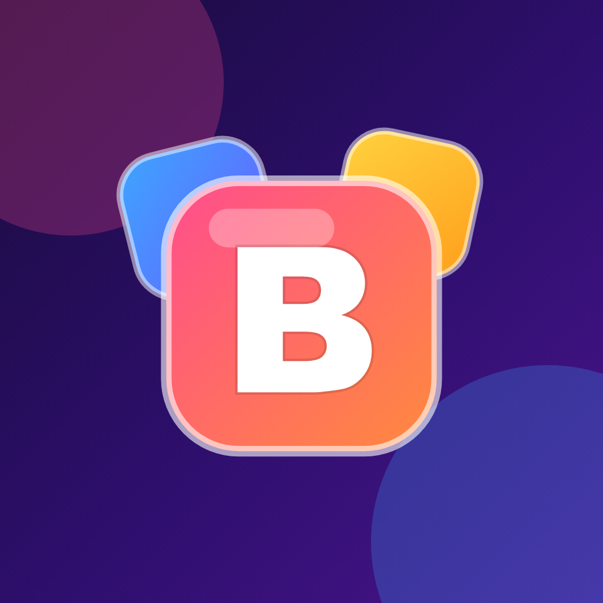

<p align="center">
  
</p>

<h1 align="center">¡Basta!</h1>

<p align="center">
  Juego de palabras para jugar en grupo con el teléfono o la tableta <b>en el centro de la mesa</b>.<br/>
  Android · iOS · Hecho con Expo + React Native · Código abierto (MIT)
</p>

---

## ¿Cómo se juega?

1. Pon el teléfono en el centro. El turno se muestra **arriba (volteado) y abajo** para que lo vean todos.
2. Sale una **categoría** (ej. *Frutas*, *Estados de México*, *Caricaturas*…).
3. En pantalla hay **6 letras** del abecedario de México (27 letras con **Ñ**).
4. En tu turno di una palabra de la categoría que empiece con una de esas letras y **tócala**.
5. La letra usada desaparece y entra otra; el turno pasa al siguiente y el reloj se reinicia.
6. Si se te acaba el **tiempo**, pierdes. ¿Alguien dijo algo que no vale? **Pausa → “Alguien se equivocó”**.

## Funciones

- 🐾 **Jugadores con avatar de animal**: 16 animales ilustrados a mano en SVG (incluye un ajolote 🇲🇽).
- 🔤 **Abecedario mexicano**: 27 letras con Ñ; opcionalmente **CH y LL**, o sin letras difíciles (K, Ñ, Q, W, X, Y).
- 🎯 **6 letras a la vez** en un tablero hexagonal alrededor del reloj; al tocar una cambia por otra.
- ⏱️ **Tiempo por turno** configurable (3 a 60 s), con vibración en los últimos 3 segundos.
- ⏸️ **Pausa con opciones**: marcar quién se equivocó, deshacer la última letra, cambiar categoría, reiniciar letras o terminar.
- ⚡️ **Partida rápida**: quien falla queda fuera; gana el último en pie.
- 🏆 **Torneo**: cada jugador tiene vidas (1–5). Cada error quita una vida y abre una ronda nueva con otra categoría. Sin vidas quedas eliminado. El campeón suma una victoria a su récord.
- 🗂️ **45 categorías** incluidas + tus **categorías personalizadas**.
- 💾 Jugadores, victorias y ajustes se guardan en el dispositivo (sin cuentas, sin internet, sin anuncios).
- 📱 Funciona en teléfono y tableta, vertical u horizontal; la pantalla no se apaga durante la partida.

## Requisitos

- [Node.js](https://nodejs.org/) 20 o superior
- Para probar en tu teléfono: la app **Expo Go** ([Android](https://play.google.com/store/apps/details?id=host.exp.exponent) / [iOS](https://apps.apple.com/app/expo-go/id982107779))

## Correr en desarrollo

```bash
git clone https://github.com/AnderCMD/Basta.git
cd Basta
npm install
npm start
```

Escanea el código QR con Expo Go (Android) o con la cámara (iOS). También puedes usar `npm run android`, `npm run ios` (requiere Xcode) o `npm run web`.

## Instalar sin publicar en tiendas

La app no está en Play Store ni App Store, pero puedes generar un instalable con [EAS Build](https://docs.expo.dev/build/introduction/) (cuenta gratuita de Expo):

```bash
npx eas-cli@latest login
npx eas-cli@latest build --platform android --profile preview   # genera un .apk para instalar directo
npx eas-cli@latest build --platform ios --profile preview       # requiere cuenta de Apple Developer
```

O compila localmente con `npx expo run:android --variant release` / `npx expo run:ios --configuration Release`.

## Scripts

| Comando             | Qué hace                                  |
| ------------------- | ----------------------------------------- |
| `npm start`         | Servidor de desarrollo de Expo            |
| `npm test`          | Pruebas del motor del juego (`node:test`) |
| `npm run typecheck` | Revisión de tipos con TypeScript          |
| `npm run lint`      | ESLint con la configuración de Expo       |

## Estructura

```
src/
  app/                 Pantallas (Expo Router)
    index.tsx          Menú principal
    players.tsx        Alta/edición de jugadores y su animal
    setup.tsx          Configurar partida rápida o torneo
    game.tsx           Tablero, reloj, pausa, eliminaciones y podio
    how-to.tsx         Reglas
    settings.tsx       Ajustes y categorías personalizadas
  components/          AnimalAvatar (SVG), LetterTile, Icon, ui
  lib/
    game.ts            Motor del juego (reducer puro, con pruebas)
    alphabet.ts        Abecedario de México y opciones
    categories.ts      Categorías incluidas
  store/AppStore.tsx   Estado global y persistencia (AsyncStorage)
```

## Ramas

- **`main`**: versión estable.
- **`dev`**: desarrollo. Los cambios entran a `dev` por Pull Request y luego se fusionan a `main`.

## Contribuir

¡Las contribuciones son bienvenidas! Lee [CONTRIBUTING.md](CONTRIBUTING.md) y el [Código de Conducta](CODE_OF_CONDUCT.md).
Ideas: más categorías, sonidos, nuevos animales, modo por equipos, traducciones.

## Licencia

Código bajo licencia [MIT](LICENSE). Los avatares de animales son originales de este proyecto y se distribuyen bajo la misma licencia.
Recursos de terceros: ver [THIRD_PARTY_NOTICES.md](THIRD_PARTY_NOTICES.md).
