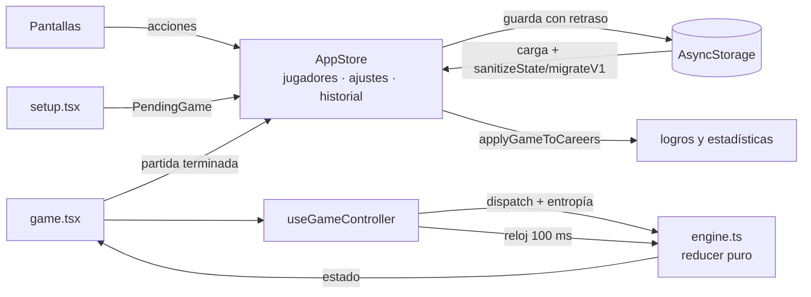

# Arquitectura

Basta es una app de **Expo SDK 58** (React Native 0.88, React 19.3, TypeScript estricto) con **Expo Router** para la navegación y **Reanimated 4** para animaciones. No tiene servidor: todo vive en el dispositivo.

## Carpetas

```
src/
├── app/                    Rutas (Expo Router): cada archivo es una pantalla
│   ├── _layout.tsx         Fuentes, sonidos, splash, proveedor de estado, ErrorBoundary
│   ├── index.tsx           Menú principal
│   ├── play.tsx            Elegir modo
│   ├── setup.tsx           Preparar partida (jugadores, equipos, reglas, modificadores)
│   ├── game.tsx            Partida (distribución vertical / tableta / teléfono horizontal)
│   ├── players/index.tsx   Lista de jugadores
│   ├── players/edit.tsx    Crear/editar jugador y su avatar
│   ├── hall-of-fame.tsx    Salón de la fama (marcadores, logros, historial)
│   ├── categories.tsx      Paquetes de categorías, buscador, categorías propias
│   ├── settings.tsx        Ajustes
│   ├── how-to.tsx          Reglas
│   └── brand.tsx           Solo desarrollo: composiciones para imágenes de marca
├── components/
│   ├── ui/                 Kit reutilizable: AppText, Button, IconButton, Card, Stepper,
│   │                       Toggle, Segmented, Chip, Overlay, Screen, Background, PressableScale…
│   ├── avatar/             Animales SVG, accesorios y <Avatar>
│   ├── Icon.tsx            Íconos de Font Awesome Free 7 (fuente TTF)
│   ├── Logo.tsx            Logotipo animado de fichas
│   └── Confetti.tsx        Confeti con Reanimated
├── features/
│   ├── game/
│   │   ├── engine.ts       ★ Motor puro del juego (reducer) + pruebas
│   │   ├── awards.ts       Premios de fin de partida
│   │   ├── modes.ts        Metadatos de modos y modificadores
│   │   ├── useGameController.ts  Une el motor con reloj, sonido y vibración
│   │   └── components/     Board, LetterTile, TimerCore, TurnBanner, PlayersStrip, Overlays
│   └── stats/
│       ├── achievements.ts Logros y estadísticas de carrera
│       └── career.ts       Suma una partida a las estadísticas (puro, con pruebas)
├── data/
│   ├── alphabet.ts         Abecedario de México y valor de cada letra
│   └── categories/         Paquetes escritos a mano + generadores de plantillas
├── lib/                    theme, responsive, haptics, sound, random, confirm, appInfo
└── store/
    ├── AppStore.tsx        Contexto global + guardado en AsyncStorage
    └── schema.ts           Tipos persistidos, validación y migraciones (con pruebas)
```

## Flujo de datos



## El motor (`features/game/engine.ts`)

- **Puro**: no usa `Math.random`, timers ni React. La aleatoriedad (mazo barajado, categoría siguiente, letras doradas) entra en las acciones (`PLAY`, `CONTINUE`, `RESET_LETTERS`…). Así cada regla se prueba con `node:test` sin emuladores.
- **Competidores**: un jugador en los modos individuales o un equipo en *Equipos*; cada uno tiene integrantes que se turnan (`memberIndex`), vidas, puntos, racha y comodines.
- **Fichas**: 6 visibles con `id` único (para animar cada letra nueva) y bandera `golden`.
- **Historial para deshacer**: cada jugada o falla guarda una copia (hasta 10).
- **Estados**: `ready → playing ⇄ paused → fail → ready … → finished`.

Para agregar una regla nueva: cambia el reducer, agrega una prueba en `engine.test.ts` y, si hace falta aleatoriedad, pásala en la acción desde `useGameController`.

## Persistencia

- Clave `basta.state.v2` con `{ version, players, settings, history }`.
- Al cargar se pasa por `sanitizeState`: cualquier dato corrupto se reemplaza por valores por defecto en vez de romper la app.
- Si no existe la v2 pero sí los datos de la v1 (`basta.players.v1`), `migrateV1` los convierte (animal → avatar, victorias → estadísticas).
- Los cambios se guardan con 250 ms de retraso para agrupar escrituras.
- La app no dibuja ninguna pantalla hasta terminar de cargar (el splash sigue visible).

## Diseño responsivo

`lib/responsive.ts` expone `useLayout()` con `isTablet` (lado corto ≥ 600), `isLandscape`, una **escala** (0.85–1.45) para tipografía y componentes y un `contentWidth` máximo. La pantalla de juego tiene tres distribuciones:

| Caso | Distribución |
| --- | --- |
| Vertical (teléfono o tableta) | Banner volteado arriba · tablero · banner abajo · jugadores |
| Horizontal alto (tableta) | Banners arriba/abajo, jugadores a un costado del tablero |
| Horizontal bajo (teléfono acostado) | Banners en columna a cada lado del tablero |

El tablero se mide con `onLayout` y calcula el tamaño de fichas y reloj a partir del lado más corto disponible.

## Versión

La versión vive **solo** en `package.json`. `app.config.ts` la lee para `version`, `android.versionCode` (1.2.3 → 10203) e `ios.buildNumber`, y la app la muestra con `lib/appInfo.ts`.

## Calidad

- `npm run check` = TypeScript estricto + ESLint (incluye reglas de React Compiler) + pruebas.
- CI en GitHub Actions corre lo mismo en cada push y PR a `main` y `dev`.
